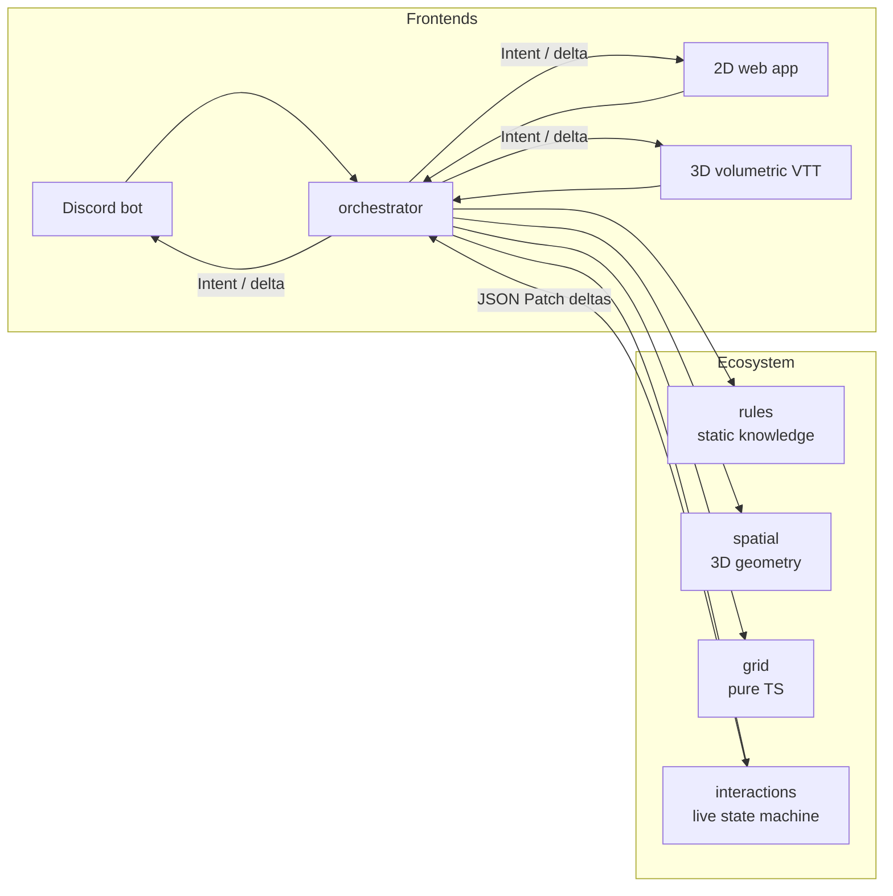

# ttrpg-engine

> A headless, system-agnostic Tabletop Roleplaying Game engine.
> TypeScript logic. Rust geometry. Deterministic, multiplayer-ready, renderer-free.

The engine isolates **data from rendering** behind a strict Redux-style event loop. Frontends dispatch a typed *Intent*; the engine applies validated math and emits a minimal RFC 6902 JSON Patch *delta* — consumed identically by a Discord bot, a 2D web character creator, or a cinematic 3D virtual tabletop.



## Packages

| Package | Purpose | Runtime deps |
|---|---|---|
| [`@ttrpg-engine/rules`](packages/rules) | Static knowledge engine: compendiums, JSON Schemas, sandboxed validators | none |
| [`@ttrpg-engine/interactions`](packages/interactions) | Live-session state machine: intents in, RFC 6902 deltas out, injected-entropy dice | none |
| [`@ttrpg-engine/grid`](packages/grid) | Tactical grid math: square/hex distances, pixel conversions, AoE cells | none |
| [`@ttrpg-engine/spatial`](packages/spatial) | Grid-agnostic 3D geometry: volumetric shapes, raycasting, LoS, lighting (pure TS) | none |
| [`@ttrpg-engine/orchestrator`](packages/orchestrator) | Glue pipeline + the fireball vertical-slice demo | the four above |

Bundle only what you need:

- **Theater of the mind** (PbtA, Vampire): `rules` + `interactions` only.
- **Gridless 3D** (TaleSpire-like): drop `grid`, keep `spatial` with unlocked Z.
- **Grid combat** (D&D/PF): all four.

## Determinism, by construction

- The engine **never generates unseeded entropy**. The authoritative side (physics dice roller, server RNG, bot crypto RNG) injects dice results into the Intent; the engine validates and applies them.
- Every client receives the **full per-die breakdown** in the delta — same numbers *and* the exact faces a 3D dice animation should land on, everywhere.
- Same Intent + same entropy ⇒ byte-identical state and deltas on every device. Multiplayer sync, replays, and tests fall out for free.

## Quickstart

```ts
import { createEngine } from "@ttrpg-engine/interactions";
import { createPipeline } from "@ttrpg-engine/orchestrator";

const pipeline = createPipeline({ engine: createEngine({ ruleset, session }), spells: compendium });
const { targets, response } = pipeline.castSpell({
  intent_id: "req_88a9f", source: "uuid-wizard-1", spell_id: "fireball",
  targeting: { mode: "area", at: { x: 65, y: 5, z: 0 } },
  entropy: { damage: { dice: [[5, 3, 1, 6, 4, 2, 4, 3]] }, target_saves: { /* id → total */ } },
});
// response.delta is a JSON Patch: apply it on every client.
```

The full end-to-end flow (fireball slice) lives in [`examples/fireball`](examples/fireball): `pnpm build && node examples/fireball/run.mjs` prints the blast as a log, and `pnpm dev:server` serves the same setup over HTTP (`POST /intent`, `GET /state`). See `docs/PRD.md` and `docs/ARCHITECTURE.md` for the complete contracts.

## Status

**v0.1.0, ready to publish** (not yet on npm). All five packages are complete, documented and checked by a release dry-run (`pnpm check:pack`); see [`docs/RELEASE.md`](docs/RELEASE.md) and [`CHANGELOG.md`](CHANGELOG.md). Slices per `docs/PRD.md` §10:

1. ✅ Scaffold — pnpm + Turborepo, TS strict, ESLint, Vitest, CI, MIT, contributor guide
2. ✅ `grid` — square/hex math
3. ✅ `interactions` — state machine + dice pipeline
4. ✅ `spatial` — locked 3D API + TS reference, lighting queries
5. ✅ `rules` — compendium + schemas + logic trees
6. ✅ Fireball vertical slice
7. ✅ Hardening — READMEs, decision records ([`docs/adr`](docs/adr)), pack dry-run
8. ⬜ Spatial benchmark gate; a Rust/wasm backend only if TS is too slow ([ADR 6](docs/adr/0006-spatial-ts-default-wasm-deferred.md))

## Contributing

MIT-licensed and dependency-light by design. See [`CONTRIBUTING.md`](CONTRIBUTING.md).